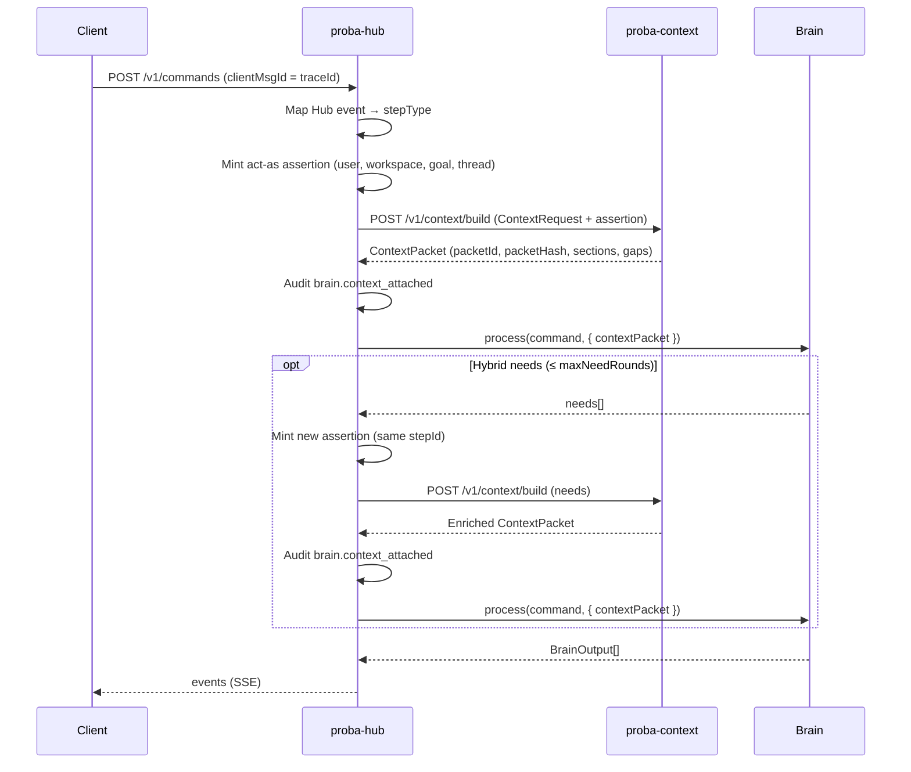

# Brain ↔ context bridge

Before every brain step the Hub asks the context bridge for a bounded packet, then
passes **only that packet** into the brain. The Hub never builds context in-process
and never falls back to an in-process builder when the bridge fails.

Bridge contract: `POST {CONTEXT_BRIDGE_URL}/v1/context/build` (see `proba-context`).
The Hub authenticates with a short-lived **act-as assertion** (`Authorization: Bearer`).

## Sequence (one step)

## Hub event → stepType

| Hub event that starts a step | stepType |
|---|---|
| User message arrives in a thread | `interpret_message` |
| Brain needs more detail (`answer_ask` clarify) | `clarify` |
| Goal accepted / `create_goal` | `plan_goal` |
| Plan needs a budget | `propose_budget` |
| Budget approved or declined | `handle_approval` |
| Campaign ready to launch | `launch_campaign` |
| New analytics / scheduled review | `review_performance` |
| User asks why (`explain` / “why…”) | `explain_decision` |

## Failure rule

If the bridge is unreachable, times out, returns an error, or the circuit is open:

1. Emit `context.build_failed` on the step trace.
2. Do **not** call the brain with partial data.
3. Either return a **clarify** ask (`CONTEXT_BRIDGE_ON_FAILURE=clarify`, default) or **hold** the step with no brain output (`hold`).

There is no in-process context builder.

## Feature flag

| Env | Meaning |
|---|---|
| `CONTEXT_BRIDGE_ENABLED` | When unset: on iff `CONTEXT_BRIDGE_URL` is set. Explicit `false` keeps the legacy in-Hub context (**local / non-production only**). |
| `CONTEXT_BRIDGE_URL` | Bridge base URL. **Required in production.** |
| `CONTEXT_BRIDGE_MAX_NEED_ROUNDS` | Hybrid needs rounds per step (default `2`). |
| `CONTEXT_BRIDGE_ON_FAILURE` | `clarify` (default) or `hold`. |

Production refuses to start when the flag is off or the URL is empty.

## Audit linkage

Each successful attach emits `brain.context_attached` with
`packetId`, `packetHash`, `stepId`, `stepType`, `configVersion` — never packet text —
so a decision trace links to exactly what the brain saw.

## Hybrid needs (mock scenarios)

- `context_analytics_compare` — first step asks `analytics_compare`; after the rebuilt packet, returns a `decision`.
- `context_need_refused` — asks `memory_search`; when the packet carries `need_refused_by_policy`, returns `clarify`.

Run with `MOCK_BRAIN_SCENARIO=context_analytics_compare` (or `#context_analytics_compare` in the goal title).
