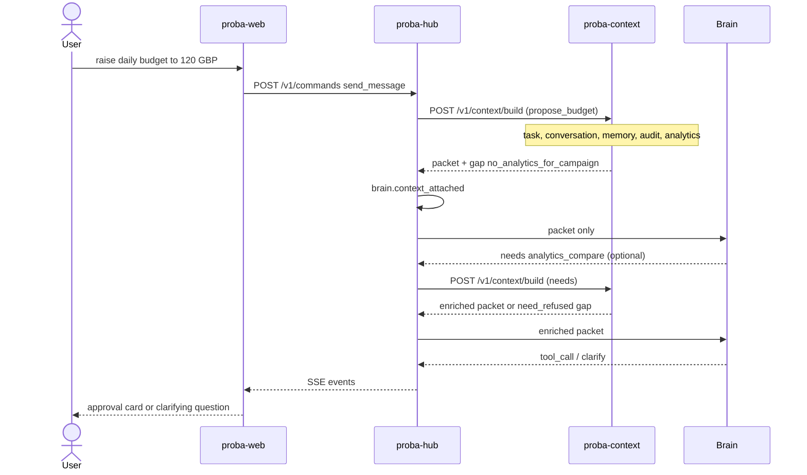

# Walkthrough: raise the daily budget to 120 GBP

End-to-end path with the context bridge wired into the Hub brain (brief 07).

## Flow

1. User (via proba-web) sends a message: “raise the daily budget to 120 GBP”.
2. Hub stores the typed message, maps the step to `propose_budget` (or `interpret_message` then a later `propose_budget` hub event), mints an act-as assertion, and calls the bridge `POST /v1/context/build`.
3. Bridge verifies the assertion, loads template v1, and in parallel reads task state / conversation (Hub internal reads), memory, audit history, and analytics.
4. Analytics may return nothing → packet gap `no_analytics_for_campaign`.
5. Hub emits `brain.context_attached` (packetId, packetHash, stepId, stepType, configVersion) on the step trace.
6. Brain sees **only** the packet. With a gap it may clarify, or ask a hybrid need such as `analytics_compare`.
7. If the brain returns `needs`, Hub mints a new assertion (same `stepId`), calls the bridge again, re-attaches, and re-invokes the brain (up to `CONTEXT_BRIDGE_MAX_NEED_ROUNDS`).
8. Brain returns a budget proposal (`tool_call` / decision card). Hub audits the output and streams events to the client.

## Sequence

## Expected audit (same traceId)

- `command.accepted` / `command.processed`
- `brain.context_attached` (before brain output)
- `brain.llm_call`
- brain output action (`brain.clarification_requested`, `brain.decision_made`, …)
- On bridge failure: `context.build_failed` and no successful brain act on partial data

See also [Brain ↔ context bridge](BRAIN_CONTEXT_BRIDGE.md) and [Act-as assertions](ASSERTIONS_AND_INTERNAL_READS.md).
